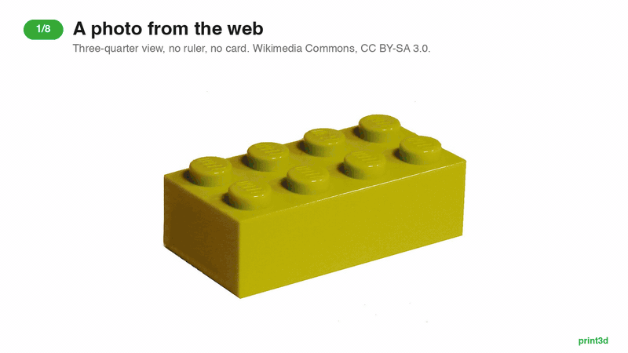
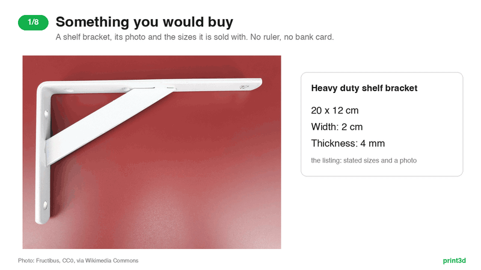

# print3d

Turn an idea, a photo of an object, or the shop listing of something you would
otherwise buy, into a Bambu Studio project for a **Bambu Lab X2D (0.4 mm nozzle)**.
One part or several, in one colour or two, with fits measured against your own
printer, and a print sheet to hand on.


*One museum photo of an old tin, and no CAD: measured off the ruler beside it,
modelled as a body, a lid, a hinge pin and a name inlaid in black, every fit
measured, the lid swung open a degree at a time to prove the hinge, sliced, and
handed on as a print sheet. It matches the photo's outline 100% and the museum's
catalogue to the millimetre. [Full-resolution video](docs/tin.mp4) ·
[stills](docs/tin/) · [the benchmark](#benchmark-a-hinged-tin-from-a-museum-photo).
Rebuild them with `scripts/tin_media.py`. Photo: Auckland Museum, CC BY 4.0.*

You (or an agent) write a Blender script that builds the part. `print3d` runs it,
checks the mesh, slices it with Bambu Studio, and tells you what to fix. Repeat
until the checks pass, then open the `.3mf` in Studio and print from there.

```
idea -> Blender script -> mesh -> checks -> slice -> .3mf -> print from Studio
             ^                      |
             +---- fix the script --+
```

Nothing here talks to the printer.

## Install

Needs [Blender](https://www.blender.org/download/) 4.2+,
[Bambu Studio](https://bambulab.com/en/download/studio) and
[uv](https://docs.astral.sh/uv/).

```bash
uv tool install git+https://github.com/mfranzon/print3d
print3d setup
```

`setup` finds Claude Code, Codex, Cursor, Gemini CLI and Hermes Agent on this
machine, shows what it will change, and on your yes registers the print3d MCP
server with each (Claude Code and Hermes also get the `/print3d` skill). Edited
config files are backed up beside themselves. Restart your agent afterwards.
`--dry-run` shows the plan without changing anything; `--agent codex` limits it
to one agent.

`print3d status` shows where Blender and Studio were found. On macOS this is
automatic; otherwise set `BLENDER_BIN` and `BAMBU_STUDIO_BIN`. Jobs go to
`~/print3d/jobs`, or `$PRINT3D_JOBS`.

To update, run `uv tool upgrade print3d`, then `print3d setup` again.

### As a Hermes plugin

Hermes Agent can install print3d as a plugin instead, with no `uv tool install`
and no `setup`. It still needs Blender, Bambu Studio and uv:

```bash
hermes plugins install mfranzon/print3d --enable
```

The plugin brings the skill and the MCP server; the server runs from the
plugin's own copy through `uvx`, and `hermes plugins update print3d` updates both.
In the Hermes desktop app, the agent opens each part's 3D view in the preview
pane beside the chat. A Desktop user can also install from a link:
`hermes://plugin/install?repo=mfranzon/print3d&enable=1`.

## Use

```bash
print3d make "a 40mm nameplate that says MARCO" --script examples/nameplate.py
```

This models, checks, slices and prints a JSON report. It exits 1 if any check
fails. Without `--script`, it writes a starter `jobs/<slug>/model.py` for you to
fill in and run again.

Output lands in `jobs/<slug>/`. Open `slice/<slug>.3mf` in Studio. The
`.gcode.3mf` next to it is the sliced job and won't open in the Prepare tab.

Other commands:

| Command | What it does |
| --- | --- |
| `model script.py out.stl` | Run a Blender script to an STL |
| `slice model.stl` | Check and slice an existing mesh |
| `check model.stl` | Printability checks only |
| `inspect job.gcode.3mf` | Time, filament and layers of a sliced job |
| `grid photo.jpg` | Pixel coordinates over a photo, or a zoomed `--crop` |
| `measure <slug> ...` | Record scale (or `rectify` an angled face), dimensions, outlines, unknowns and the shop `listing` in `spec.json` |
| `meet edge edge` | The corner where two edges cross, when it is hidden |
| `likeness <slug>` | Compare the mesh with the photographed outlines |
| `handoff <slug>` | Print sheet, renders, the `.3mf` and an STL per part, in `jobs/<slug>/handoff/` |
| `view <slug>` | Rebuild `jobs/<slug>/view.html`, the model in 3D to rotate and pull apart |
| `coupon` | Slice the fit coupon that calibrates your printer's clearances |
| `fit show` / `fit set` | The clearance per fit that scripts get as `params["fit"]`, and recording yours |
| `plan model.stl out.gcode.3mf` | Show the Studio command without running it |
| `flatten` | Rebuild the X2D presets in `src/print3d/profiles/x2d-0.4/` |
| `setup` | Register print3d with your agents |
| `mcp` | Run the MCP server on stdio (agents launch this) |

## Writing a model script

Plain bpy that builds geometry. `examples/nameplate.py` is the reference.

- 1 Blender unit = 1 mm.
- `params` holds the brief: `prompt`, `slug`, `text`, `intent`, `size_mm`,
  `color`, `material`, the photo's `dims`, and `fit`: this printer's clearance
  for a press, snug, slide or free fit.
- More than one part? Model them assembled and name each with `part()`; see
  [Parts, colours and fits](#parts-colours-and-fits).
- Leave the part as mesh objects. `print3d` joins them, cleans the mesh, centres
  it and puts it on the bed.
- Orientation is up to you. Studio's auto-orient is off, so the part prints the
  way you model it.

More recipes and gotchas: `src/print3d/skill/references/modelling.md`.

## From a photo

Photograph the object square-on, from a distance, next to something of known
size: a bank card, a coin, an A4 sheet, a ruler. `print3d` turns the photo into
measurements you can trace back, and checks that the model looks like it.

```bash
print3d grid knob.jpg --crop 120,340,260,420     # read exact pixels off a zoomed crop
print3d measure knob scale front knob.jpg --ref card --points 131,352,559,352
print3d measure knob dim diameter --view front --points 610,400,790,400
print3d measure knob dim bore --mm 6 --source user
print3d measure knob outline front --points 610,300,790,300,790,520,610,520
print3d make "knob"                               # the model reads params["dims"]
```

Each dimension in `jobs/<slug>/spec.json` records where it came from (measured,
given by you, or assumed with a reason) and, when measured, the pixels, the
reference and a tolerance. Whatever no photo shows is listed as an unknown.

Every outlined view adds a **likeness** check to the run. The STL is projected
along that view, scaled to the photo, and laid over it. If the shape or size
is wrong, or the part is turned or mirrored, the run fails just like it does for
an overhang. `jobs/<slug>/likeness/<view>.png` shows the difference: red is in
the photo but missing from the model, blue is in the model but not in the photo.

Most photos are taken at an angle. `measure rectify` takes the four corners of
a flat face of known size (the object's own top, a card it lies on) and warps
the photo so that face is seen square-on; every later point for that view is
read off the rectified image. When a corner hides behind something, `print3d meet`
finds it where its two edges cross.

The full workflow is in `src/print3d/skill/references/from-photo.md`.

### Benchmark: a clothes peg from a museum photo



*Scale it from the ruler, measure with evidence, model, check the match, slice.
[Full-resolution video](docs/workflow.mp4) · [stills](docs/workflow/). Rebuild
them with `scripts/workflow_media.py`.*

A wooden dolly peg from the Auckland Museum collection, photographed square-on
beside a centimetre ruler. The scale comes from the ruler (6 to 20 cm, 140 mm
across 905 px), never from the peg, and the result is scored against the
museum's catalogue record:

| | from the photo | catalogue |
| --- | --- | --- |
| length | 114.9 ± 1.2 mm | 115 mm |
| diameter, widest (across the spring) | 18.7 ± 0.7 mm | 20 mm |
| slot | 49% of the length | "approximately half way" |

The catalogue rounds to 5 mm, so both readings land inside it; the diameter's
1.3 mm gap is about what that rounding allows, not a measurement you should
trust to a tenth. The knob, neck, body and slot are measured too; the catalogue
has nothing to score them against.

The peg built from those numbers (`examples/dolly_peg.py`) covers the photo's
outline at 90%, after the likeness check levels the photo by 1.5 degrees, and
slices clean: 575 layers, 49 minutes, 7.2 g. It prints standing on its knob,
and the run says so honestly: a 115 mm part on a 14.5 mm foot is slender, so
add a brim in Studio. What the photo cannot give is recorded as such: the
spring is steel wire and is not printed, and the end chamfers are assumed.

Replay it with `pytest tests/test_peg_benchmark.py`; the end-to-end Blender and
Studio run is in `tests/test_studio_it.py`.

Photo: "Peg, clothes (AM 1999.92.3-1)", Collection of Auckland Museum Tāmaki
Paenga Hira, 1999.92.3,
[CC BY 4.0](https://creativecommons.org/licenses/by/4.0/), via
[Wikimedia Commons](https://commons.wikimedia.org/wiki/File:Peg,_clothes_(AM_1999.92.3-1).jpg).
`docs/workflow*` are made from it.

### Benchmark: a hinged tin from a museum photo

A Gallaher's tobacco tin from the Auckland Museum collection, photographed from
straight above with its lid open and a centimetre ruler along the bottom. The
scale comes from the ruler (4 to 24 cm, 200 mm across 1313 px), and the
result is scored against the museum's catalogue record:

| | from the photo | catalogue |
| --- | --- | --- |
| length | 81.9 ± 0.9 mm | 81 mm |
| depth | 56.8 ± 0.8 mm | 57 mm |
| height | not visible from above | 20 mm, used as given |

The corners are measured too, and the hinge side's are tighter (2.7 mm against
5.2 mm), so the model has them that way. The length is read along the rim,
which stands 20 mm above the ruler and so photographs about 1% large. The depth
is read where the front wall meets the table and comes out true. The lid lies
open and foreshortened, so its height is assumed and recorded as such.

`examples/tobacco_tin.py` builds it from those numbers in four parts. What the
photo cannot give is redesigned for printing, and the unknowns say so: the
rolled tinplate hinge becomes a printed barrel hinge inside the footprint, with
a pin pressed into the body's knuckles and free in the lid's; the lid's
illustration becomes a name inlaid in black; the 0.3 mm tinplate becomes 1.6 mm
walls. Every knuckle and bore is a teardrop, so nothing needs support.

The run checks it like any other: the closed tin covers the photo's outline at
100%, and all three fits measure as declared (snug 0.10, press 0.05, free 0.35
mm). Then `scripts/tin_media.py` swings the lid about the pin a degree at a time
against the body: it squeezes 0.10 mm over the first few degrees, so it clicks
shut, swings free to 90° and stops upright. It slices clean on one plate in 51
minutes: 28.8 g of gold and 0.8 g of black.

Replay the measurements with `pytest tests/test_tin_benchmark.py`; the
end-to-end run is in `tests/test_studio_it.py`. Photo: "Tin, tobacco (AM
679921-1)", Collection of Auckland Museum Tāmaki Paenga Hira,
[CC BY 4.0](https://creativecommons.org/licenses/by/4.0/), via
[Wikimedia Commons](https://commons.wikimedia.org/wiki/File:Tin,_tobacco_(AM_679921-1).jpg).
`docs/tin*` are made from it.

## Instead of buying it



*A shelf bracket from its stated sizes: quote them, scale the photo from one,
measure the rest back, model, check the match, slice.
[Full-resolution video](docs/listing.mp4) · [stills](docs/listing/). Rebuild
them with `scripts/listing_media.py`. Photo: Fructibus, CC0.*

You usually don't have the thing you are about to buy, so there is no photo of it
next to a bank card. The shop listing stands in: its stated sizes are the
evidence, and one of them scales its product photos.

```bash
print3d measure hook listing https://shop.example/hook --price 4.99 --currency EUR
print3d measure hook dim length --mm 120 --source listing --quote "Dimensions: 120 x 45 x 30 mm"
print3d measure hook scale side hook-side.jpg --ref dim:length --points 52,410,1490,402
print3d measure hook dim length_measured --view side --points ...   # measure a second listed size back
```

A listed dimension needs its `--quote`, the listing's own words, and carries the
listing's rounding (`--tolerance 5` for a size given in cm) into everything
measured off a photo it scaled. Measuring a second listed size back off the
photo catches a photo in perspective, a different variant, or the box's size
quoted as the product's. The run reports the listing beside the print's grams
and time. The workflow is in `src/print3d/skill/references/from-listing.md`.

### Benchmark: a shelf bracket from its stated sizes

A heavy-duty shelf bracket, photographed lying on its side, with its sizes stated
the way a listing states them: "20 x 12 cm. Width: 2 cm. Thickness: 4 mm". The
long leg scales the photo; the other three are measured back and scored against
what was stated:

| | stated | from the photo |
| --- | --- | --- |
| short leg | 12 cm (115 to 125 mm) | 126.9 ± 4.2 mm |
| width (across the strut, same bar) | 2 cm | 21.6 ± 1.2 mm |
| thickness | 4 mm | 3.4 ± 0.7 mm |

All three agree within the stated rounding plus the photo's tolerance. The short leg
is the interesting one: the listing rounds it to the centimetre, and the photo
pins it tighter, so the model uses the photo's 127 mm. A 120 mm leg would have
missed the photo by 7 mm. The screw holes (29 mm from the corner on both legs)
and the strut are measured too; the bore is assumed, since the photo sees the
holes edge-on.

`examples/shelf_bracket.py` prints it lying on its side with teardrop screw holes,
covers the photo's outline at 89%, and slices clean: 100 layers, 40 minutes,
25.6 g. The legs stand 20 mm off the table, so their sides show in perspective;
every point is read on the top plane, and 89% is about what that allows. Steel at
4 mm carries a shelf and PLA at 4 mm will not, so the run records it as an unknown
rather than pretending the replica is a drop-in.

Replay it with `pytest tests/test_bracket_benchmark.py`. Photo: Fructibus,
[CC0](https://commons.wikimedia.org/wiki/File:Gray_metallic_shelf_bracket_-_20_x_12_cm_-_F.jpg).

## Parts, colours and fits


Most things worth designing are more than one solid. Model every part where it
sits when assembled, name it, and say how it turns to print. The run checks each
printed object on its own, measures the gaps between parts, gives each colour its
own filament on the X2D's two nozzles, and slices all of it into one project.

```python
c = params["fit"]["slide"]                       # this printer's slide clearance
plug = box(36 - 2 * c, 26 - 2 * c, 4)            # sized from it, not guessed
...
part(body, "body", color="white")
part(lid, "lid", color="white", rotate=(180, 0, 0))            # prints upside down
part(name, "name", color="black", group="lid", rotate=(180, 0, 0))  # inlaid, fused with the lid
part(spare, "spare", plate=2, settings={"wall_loops": 4})      # its own plate, stronger
fit("lid", "body", "slide")
```

`examples/lidded_box.py` is the worked version: it slices clean in 38 minutes,
25.4 g of white and 0.17 g of black, and the slide fit measures 0.20 mm per side
as declared.

`examples/pen_caddy.py` goes further: a cup that spins on a base around a
printed axle, with three different fits on one axle (press into the base, free
in the cup, snug under the cap), an orange band inlaid around the cup's curved
wall, the axle printed solid through per-part settings, and two plates: the
small parts that carry the fits first (52 minutes), so you can try them before
the 2 h 18 min cup. All three fits measure as declared.
`examples/tobacco_tin.py`, the GIF at the top, does it all from a photo: a
hinged tin with a working barrel hinge, [benchmarked](#benchmark-a-hinged-tin-from-a-museum-photo)
against the museum's catalogue.


The run fails when parts **interfere** (they would not go together) or when a
colour part is **buried** inside its partner and would never show, and warns when
a declared fit is tighter or looser than intended. Every note names its part.

Fits default to the usual 0.4 mm-nozzle numbers (press 0.05, snug 0.10, slide
0.20, free 0.35 mm per side). To use your printer's own, print the coupon, a
pin and eight holes from 0.00 to 0.40 mm, and record what you feel:

```bash
print3d coupon
print3d fit set --press 0.05 --snug 0.10 --slide 0.15 --free 0.30
```

From then on every script gets them in `params["fit"]` and every run measures
against them. The full guide is in
`src/print3d/skill/references/parts-and-fits.md`.

## Hand it off

```bash
print3d handoff <slug> --currency EUR
```

[](docs/parts/print-sheet.png)

`jobs/<slug>/handoff/` gets a one-page print sheet for a client, a teammate or a
print shop: renders of the part assembled and exploded, time, grams and material
cost (beside the listing's price when it replaces something you would buy), the
parts and colours, how each fit measured, every dimension with its evidence, what
is still unknown, and the open notes. The Studio `.3mf` and an STL per part, in
print pose, sit next to it. The sheet is one self-contained HTML file that prints
to A4.

## What gets checked

- **The mesh:** overhangs steeper than 45°, bed contact, tall-and-narrow parts,
  parts too thin to print. Supports are off in the pinned preset, so an overhang
  is a real defect.
- **The slice:** print time, filament, and how much material each layer adds.
- **The likeness**, when you worked from a photo: outline overlap and size
  against each photographed view.
- **The fits**, when there are several parts: interference, declared fits
  against your printer's clearances, and colour parts that would not show.

Every problem comes with a `fix` telling you what to change in the script.
`jobs/<slug>/history.jsonl` keeps a record of each run.

## Use it from your agent

After `print3d setup`, ask your agent for a part. In Claude Code or Hermes:

```text
/print3d a 40mm nameplate that says MARCO
/print3d recreate the knob in ~/Desktop/knob.jpg, it sits on a 6 mm D-shaft
/print3d recreate the tin in ~/Desktop/tin.jpg with a hinge that works, "SD CARDS" on the lid
/print3d a box for business cards with a sliding lid, ACME inlaid in black
/print3d replace this instead of buying it: https://shop.example/wall-hook
```

Codex, Cursor and Gemini get the same steps through MCP: `guide`, `make`,
`grid`, `measure_*`, `set_listing`, `likeness`, `check`, `handoff`,
`fit_coupon` and `fits`. Tools that make pictures (the
coordinate grid, the plate preview, the likeness overlays) return them as
images, so the agent sees what it built.

Every run also writes `jobs/<slug>/view.html`: the model in 3D, to rotate, zoom,
hide parts and pull them apart. It is one self-contained file (three.js loads
from a CDN). In the Hermes desktop app the agent opens it in the preview pane
beside the chat; anywhere else, open it in a browser.

## Develop

```bash
git clone git@github.com:mfranzon/print3d.git && cd print3d
uv venv && uv pip install -e '.[dev]'
.venv/bin/print3d setup                             # point your agents at this checkout
.venv/bin/python -m pytest -q                       # unit tests
PRINT3D_STUDIO_IT=1 .venv/bin/python -m pytest -q   # also runs Blender and Studio
```

In a checkout, jobs go to `jobs/` in the repo.
